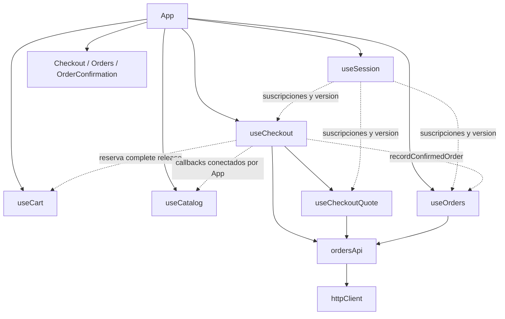

# Bloque 5: checkout, confirmación e historial de pedidos

Fecha de verificación: 22 de octubre de 2026.

## Alcance y preparación

Se verificó en GitHub que los PR #18, #19, #20 y #21 están fusionados en main. Se actualizó la copia limpia mediante fast-forward hasta `cb2d79f63b75ab7c0c99722732e0a959d20637fd`, se comprobaron useSession/useCart/useCatalog/cartApi/productsApi y se creó el worktree aislado `refactor-05-checkout-pedidos`, inicialmente limpio, con rama `refactor/05-checkout-pedidos`.

No se sobrescribieron los cambios del checkout original. No se modificaron backend, base de datos, dependencias, estilos, rutas, lógica optimista del carrito ni arquitectura del catálogo.

El backend se consultó exclusivamente en modo lectura: main remoto y checkout local en `fac4bff419b190a49340b25dd829e88182ed9014`. Se analizaron OrderController, OrderServiceImpl, CheckoutRequest, CheckoutPreviewResponse, OrderResponse, OrderItemResponse y OrderPromotionResponse.

Contratos confirmados:

- POST /orders/preview recibe paymentMethod; el servidor calcula subtotal, promociones, descuento y total.
- POST /orders recibe paymentMethod, expectedTotal y requestKey. Responde **201**, también cuando recupera una orden idempotente.
- La búsqueda de un requestKey del mismo usuario ocurre antes de validar el carrito. Un replay exige el mismo medio de pago y total.
- Un total cambiado genera 409. Stock, creación y vaciado se coordinan transaccionalmente en el backend con bloqueos.
- La orden nueva queda **PENDIENTE**. No se procesa ni se simula un pago real.
- GET /orders devuelve resúmenes del usuario. GET /orders/{id} devuelve el detalle con ítems y promociones.

## Arquitectura y dependencias



Las flechas de coordinación representan parámetros y callbacks, no importaciones entre dominios. useCheckout no importa useCart, useCatalog o useOrders. ordersApi no conoce React ni navegación. No se añadió un Provider: App conserva una única instancia de cada hook y entrega sus resultados a las vistas.

| Módulo | Responsabilidad |
| --- | --- |
| ordersApi | Solicitudes HTTP y validación del contrato de confirmación; clasificación de resultados ambiguos |
| useCheckoutQuote | Ciclo de cotizaciones, revisiones, cancelación, validación y reintentos |
| useCheckout | Intento de compra, UUID, envío único, errores, confirmación transitoria y coordinación pública |
| useOrders | Historial, detalles, cachés, solicitudes compartidas, invalidación y errores |
| App | Composición, navegación y conexión de callbacks entre dominios |
| Checkout.jsx | Paso visual, controles y presentación de los datos del hook |
| Orders.jsx | Filtro visual, pedido expandido y presentación |
| OrderConfirmation.jsx | Presentación de la última orden validada o mensaje seguro sin estado |

Se separó la cotización en un hook pequeño porque su ciclo cancelable es distinto del POST de confirmación, que debe sobrevivir a la navegación. El historial y sus detalles forman una misma responsabilidad de caché y permanecen juntos en useOrders; no se construyó un hook que concentre todos los pedidos y el checkout.

## Responsabilidades extraídas

De App salieron previewOrder, confirmOrder, confirmedOrder, orderHistory, orderDetails, ordersCache, ordersRequest, orderDetailRequests, orderDetailsCache, publishOrderDetails, resetOrderData, loadOrders, loadOrderDetail y sus efectos de carga/vencimiento.

Checkout.jsx dejó de guardar una segunda implementación del intento, UUID, cotización, estado de envío y errores de confirmación. Conserva únicamente step como estado visual. La transformación de descuentos para PurchaseSummary sigue siendo presentación; no calcula promociones alternativas.

App conserva los dominios pendientes: publicaciones, perfil, reseñas y administración de promociones, además de composición y rutas. Sus callbacks conectan la confirmación con historial, catálogo y navegación.

Conteo físico, incluyendo líneas vacías:

| Archivo | Antes | Después | Reducción |
| --- | ---: | ---: | ---: |
| App.jsx | 874 | 713 | 161 (18,4 %) |
| Checkout.jsx | 112 | 74 | 38 |

## Interfaces públicas

```js
const checkout = useCheckout({
  active, user, token, cart, cartBusy, isCartPending, beginCheckout,
  sessionVersion, sessionAbort, subscribeSessionChange, logout, setSessionError,
  onOrderConfirmed, onCatalogInvalidated, onConfirmed,
})
// paymentMethod, changePaymentMethod(next)
// quote, quoteError, retryQuote()
// submitting, submitError, confirmationBlocked
// confirmOrder(), confirmedOrder

const orders = useOrders({
  user, token, sessionVersion, sessionAbort,
  subscribeSessionChange, logout, setSessionError, active,
})
// orderHistory, orderDetails
// loadOrders(force = false), loadOrderDetail(orderId)
// recordConfirmedOrder(order)
```

App conecta onOrderConfirmed con recordConfirmedOrder, onCatalogInvalidated con refreshPendingCatalog y onConfirmed con la navegación a /pedido-confirmado. Las referencias internas y mapas de caché no se exponen.

Servicio:

```js
previewOrder(paymentMethod, { token, signal })
createOrder({ paymentMethod, expectedTotal, requestKey }, { token, signal })
getOrders({ token, signal })
getOrderDetail(orderId, { token, signal })
```

Todos reutilizan httpClient. El JWT y la señal se reciben por solicitud, sin variables globales mutables ni reintentos automáticos.

## Cotizaciones

La cotización está asociada a usuario, contenido del carrito, medio de pago, revisión e intento explícito. Cambiar carrito o medio invalida el resultado, incluso si luego se vuelve al valor anterior. Mientras hay una actualización incompatible del carrito no se cotiza ni se confirma.

Cada efecto posee AbortController y combina su señal con la de sesión. También comprueba montaje y versión de sesión: ignorar AbortSignal en el transporte no permite publicar una cotización antigua. La microtarea previa al envío evita el POST del montaje descartado por StrictMode.

Se validan importes finitos y no negativos, promociones y sus datos de presentación. Se conservan exactamente los importes del servidor. Un error requiere reintento explícito. La navegación sin cambios conserva el estado del mismo intento, especialmente si hay una confirmación ambigua.

## Idempotencia y recuperación

La clave crypto.randomUUID() se crea al preparar la primera confirmación de una cotización aceptada, no en cada render ni en cada clic. El intento conserva payload, revisión de cotización y firma del carrito.

- El ref de operación bloquea sincrónicamente dos eventos antes de que React vuelva a renderizar.
- beginCheckout reserva el carrito antes de enviar POST /orders.
- Un reintento del mismo intento conserva paymentMethod, expectedTotal y requestKey.
- Un rechazo explícito 409 descarta ese intento, solicita nueva cotización y mantiene el mensaje existente. El nuevo total exige **otro clic** y otro intento; no se confirma automáticamente.
- Fallos de red, abortos, HTTP 5xx y respuestas exitosas sin un detalle válido se consideran ambiguos: no prueban que el backend haya rechazado la operación.
- Ante ambigüedad se conserva el intento y se informa que se revisen los pedidos. No se inicia un reintento automático.
- Si cambió carrito, medio o importe respecto del intento ambiguo, se bloquea otra confirmación. No se envía la clave vieja con otros datos ni se genera silenciosamente otra.
- Volver a los datos originales permite recuperar con el mismo payload y UUID. El resultado del servidor, no una orden inventada en React, determina la confirmación.

Este control del carrito es relevante: el backend puede devolver un pedido existente por UUID sin consumir un carrito nuevo. Reutilizar esa clave con otro carrito y luego vaciarlo localmente sería incorrecto; la firma del carrito lo impide.

**Límite deliberado:** el intento vive en memoria de la instancia de App. Sobrevive a cambios de pantalla, pero no a recargar/cerrar el navegador ni al cierre de sesión. No se introdujo persistencia adicional ni un protocolo de recuperación. Si hubo un resultado ambiguo y se abandona esa instancia, se deben revisar los pedidos antes de iniciar otra compra. El contrato actual no ofrece consulta por requestKey, por lo que no se puede reconciliar automáticamente una compra distinta por su importe. Esta limitación queda explícita para la revisión integral.

## Carrito, catálogo y confirmación

La reserva conserva complete/release del bloque 3. Se libera al terminar; useCart verifica que siga perteneciendo a la operación y sesión vigentes. Un fallo conserva el carrito. La respuesta de A no puede vaciar ni desbloquear el carrito de B.

Solo un HTTP 201 con detalle válido y correspondiente al medio/total del intento, para la sesión actual:

1. Invalida el historial y precarga el detalle completo.
2. Actualiza confirmedOrder.
3. Invalida el catálogo mediante refreshPendingCatalog.
4. Ejecuta complete para reflejar el vaciado que hizo el backend.
5. Notifica la navegación a /pedido-confirmado.

No hay GET adicional del carrito ni del detalle recién confirmado. El catálogo se consulta cuando lo requieren sus consumidores. El estado confirmado se limpia al cambiar de sesión; recargar directamente /pedido-confirmado mantiene el mensaje seguro de ausencia de compra confirmada.

## Caché de pedidos

- TTL de **60 segundos**, conservado para lista y detalles.
- items: null distingue una lista no cargada de un historial vacío válido.
- Las solicitudes pendientes se comparten, incluso cuando se cambia de pantalla.
- Navegar de vuelta dentro del TTL reutiliza la lista; abrir/cerrar un detalle vigente lo reutiliza.
- loadOrders(true) actualiza manualmente, sin duplicar una solicitud pendiente.
- Mientras la ruta del historial está activa, el temporizador renueva al vencer; al volver después del TTL también se renueva.
- Una lista nueva cancela y descarta detalles enviados antes de ella.
- Se reutilizan detalles completos del propio listado. Un detalle anterior se conserva solo si sigue fresco y coinciden state, orderDate, paymentMethod, subtotal, totalDiscount y total.
- Los errores conservan los datos previos y permiten reintentar. Una compra confirmada invalida la lista y guarda su detalle.

## Aislamiento entre sesiones

useOrders, useCheckout y useCheckoutQuote usan la suscripción pública de useSession para limpiar datos privados y cancelar/inutilizar solicitudes al cambiar de usuario. Las respuestas requieren la versión, señal, montaje e identidad de operación actuales. HTTP 401 conserva logout y el mensaje de sesión vencida.

No se crean sesiones nuevas ni se modifica la autenticación. La caché de pedidos no es global ni se comparte entre instancias. Las pruebas incluyen transportes que ignoran el aborto, cambio A → B, confirmaciones tardías y bloqueos de B que una respuesta de A no puede liberar.

## Archivos

Creados:

- src/services/ordersApi.js
- src/hooks/useCheckout.js
- src/hooks/useCheckoutQuote.js
- src/hooks/useOrders.js
- tests/orders-api.test.mjs
- tests/checkout-quote.test.mjs
- tests/checkout.browser.mjs
- docs/refactor-checkout-pedidos.md

Modificados:

- src/App.jsx
- src/views/Checkout.jsx
- tests/cart-api.browser.mjs
- tests/cart-architecture.test.mjs
- tests/orders-cache.browser.mjs

## Resultados reales

| Verificación | Resultado |
| --- | --- |
| npm run lint | PASS |
| npm run build | PASS; 97 módulos |
| auth-api.test.mjs | 28 PASS |
| cart-api.test.mjs | 13 PASS |
| cart-architecture.test.mjs | 5 PASS |
| products-api.test.mjs | 19 PASS |
| product-cache.test.mjs | 17 PASS |
| orders-api.test.mjs | 32 PASS |
| checkout-quote.test.mjs | 10 PASS |
| Total Node | **124 PASS**, 0 fallos y 0 omitidas |
| checkout.browser.mjs | **20 escenarios PASS** |
| orders-cache.browser.mjs | **10 grupos PASS** |
| cart-api.browser.mjs | **22 escenarios PASS** |
| auth-session.browser.mjs | **27 escenarios PASS** |
| catalog.browser.mjs | **13 escenarios PASS** |
| promotions.browser.cjs | **12 escenarios PASS** |
| frontend-audit.mjs | **18 escenarios PASS**, 37 solicitudes |
| git diff --check | PASS |

Las pruebas nuevas de API verifican cuerpos, URL, señal, autorización por llamada, HTTP 201, errores/códigos, detalles inválidos y resultados ambiguos. Las de cotización validan el contrato sin recalcular importes. La arquitectura verifica ausencia de ciclos, una instancia de cada dominio y que los endpoints de pedidos pertenezcan al servicio.

El navegador ejecuta React real bajo StrictMode con Edge y **HTTP simulado**. Se controlan reloj, respuestas pendientes, errores y cancelaciones. Hay cobertura de cambios de pago/carrito, retornos al valor original, conflicto 409, aceptación explícita, doble clic, replay tras orden ya creada, navegación, ambigüedad con datos distintos, bloqueo, carrito vacío/conservado, invalidación de productos, confirmación sin estado tras recarga, caché, detalles, 401 y cambio de sesión.

### Fallos detectados y correcciones

- El fixture anterior de cart-api.browser simulaba confirmación HTTP 200. OrderController responde 201. Se corrigieron únicamente el estado del fixture, su vaciado exitoso y clasificación de errores; no se retiraron ni debilitaron sus aserciones.
- La primera ejecución de checkout detectó que pasar de transferencia a tarjeta y volver antes de terminar reutilizaba la cotización anterior (2 POST en lugar de 3). Se añadió una revisión de entradas que invalida incluso al volver al valor original. Las 20 pruebas terminaron PASS después de la corrección.
- La suite previa de pedidos mantiene sus seis grupos y añade cuatro: lista inválida con recuperación, detalle inválido, resumen idéntico que reutiliza detalle y 401 del detalle.

### Comandos de reproducción

```powershell
npm run lint
npm run build
node --test tests/*.test.mjs
npm run dev -- --host 127.0.0.1 --port 5173 --strictPort

# En otra terminal, con Microsoft Edge y Playwright disponibles:
$env:BASE_URL = 'http://127.0.0.1:5173'
# Si Playwright es externo, PLAYWRIGHT_MODULE indica esa instalación.
node tests/checkout.browser.mjs
node tests/orders-cache.browser.mjs
node tests/cart-api.browser.mjs
node tests/auth-session.browser.mjs
node tests/catalog.browser.mjs
node tests/promotions.browser.cjs
node tests/frontend-audit.mjs
git diff --check
```

Se reutilizaron node_modules y Playwright del entorno existente; no se instalaron dependencias ni se modificaron package.json/lockfile.

## Validación pendiente y riesgos

Por decisión explícita de este bloque, **no se ejecutaron pruebas reales con Spring Boot/PostgreSQL**. No se ejecutaron frontend-http-audit.mjs ni promotions.live.cjs, ni se modificaron credenciales, Supabase o bases compartidas. Los resultados anteriores no se presentan como integración real aprobada.

Pendiente para la comprobación integral del usuario: confirmar que se persiste una única orden PENDIENTE tras respuesta perdida/replay, que stock y carrito cambian transaccionalmente, y que el historial recupera exactamente los datos de cada usuario. También queda la revisión visual manual completa.

La recuperación ambigua tras recarga/cierre tiene el límite de memoria indicado arriba. El frontend tampoco resuelve cambios desde otra pestaña: el backend continúa siendo la autoridad sobre carrito, stock, importes e idempotencia.

El bloque entrega separación de responsabilidades y validación automatizada del frontend; no modifica el protocolo ni amplía el alcance a publicaciones, promociones administrativas o perfil.
