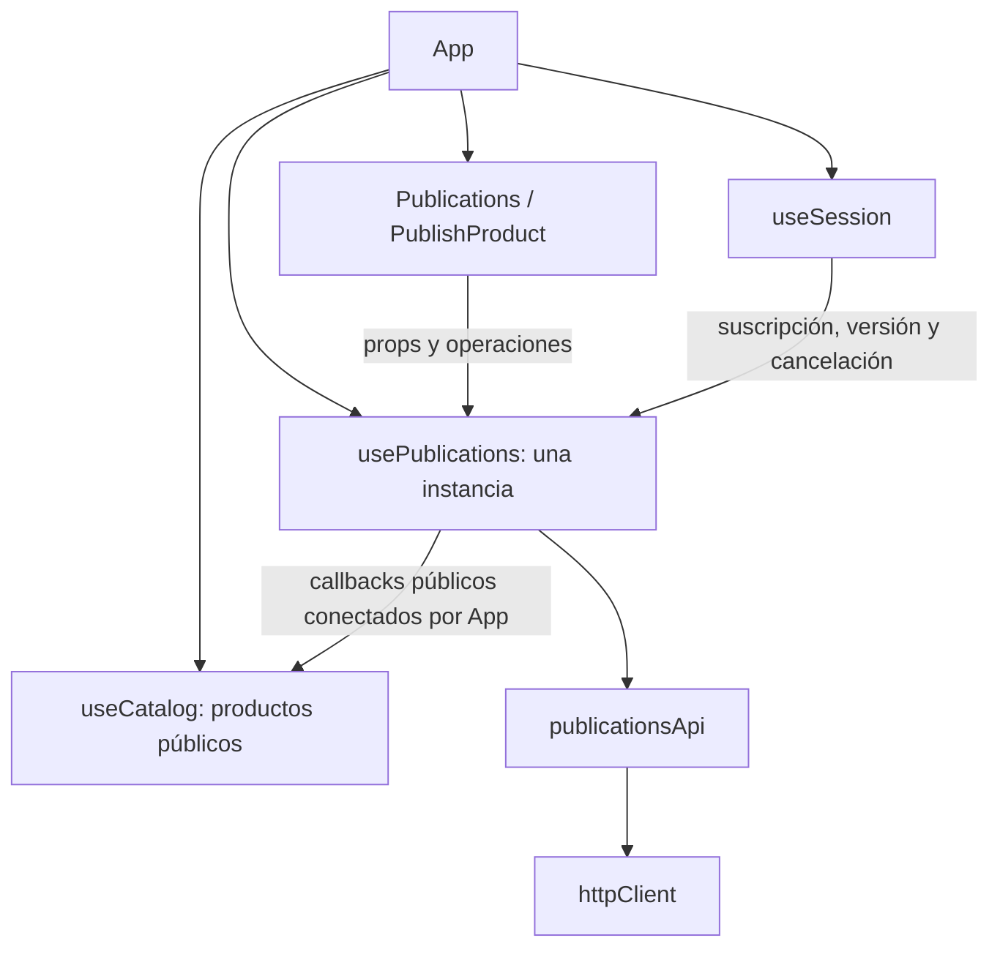

# Bloque 6: publicaciones de productos

Fecha: 23 de octubre de 2026. Rama: `refactor/06-publicaciones`.

## Preparación y alcance

Se verificó que el PR #22 estaba fusionado. El worktree aislado se creó desde
`main` actualizado, en `debed7f4ee7e93280d99fef18a129f9f6788064e`, sin cambios locales.
Se preservó el checkout original del equipo y los worktrees anteriores.

Los contratos se consultaron en `ProductsController`, `ProductRequest`,
`ProductResponse`, `ProductServiceImpl` y `ProductRepository` del backend,
revisión `fac4bff419b190a49340b25dd829e88182ed9014`, coincidente con su `main` remoto.
No se modificaron esos archivos ni se ejecutaron solicitudes contra Spring Boot.

La extracción abarca exclusivamente publicaciones propias, sus mutaciones e imágenes.
No cambia rutas, estilos, reglas de promociones, checkout, pedidos, carrito,
autenticación, perfil ni reseñas.

## Arquitectura antes y después

Antes, App mantenía `ownPublications`, su marca de caché, reintentos, errores,
`publicationBusyId`, paginación privada y validación de respuestas. También
implementaba HTTP de imágenes, creación, edición, pausa, reactivación y eliminación.

Ahora:



`usePublications` administra un único listado privado, su vigencia y solicitudes.
No importa otros hooks de dominio. `publicationsApi` transporta y valida respuestas;
no conoce React ni navegación. Las vistas conservan formularios, previews, errores
visuales y validaciones de interfaz. App conserva composición, selección de la
publicación que se edita, navegación tras guardar y el diálogo de eliminación.

No se añade Provider: las dos vistas ya reciben props de una única instancia en
App y la navegación no destruye su estado. El catálogo mantiene su propia fuente
de productos públicos; el listado del vendedor incluye estados privados y no la
sustituye. No se agregó un hook de imágenes: el formulario ya resuelve la selección
y reutilización de archivos, y el envío usa la misma coordinación de operaciones.

App pasó de **713 a 558 líneas físicas**: se retiraron 155 líneas netas, con una
responsabilidad completa separada. El hook tiene 172 líneas y el servicio 64.

## Archivos

Creaciones:

- `src/services/publicationsApi.js`: operaciones HTTP y validación de respuestas.
- `src/hooks/usePublications.js`: estado privado, caché, concurrencia y ciclo de sesión.
- `tests/publications-api.test.mjs`: contratos y fallos del servicio.
- `tests/publications.browser.mjs`: 32 escenarios con navegador real y HTTP simulado.
- `tests/fixtures/publications-harness.js`: montaje de los hooks reales para
  intercalar deliberadamente una recarga y una edición, sin depender del bloqueo
  visual del formulario. Comprueba el resultado privado y la caché pública.
- `docs/refactor-publicaciones.md`: este informe.

Modificaciones:

- `src/App.jsx`: sustituye estados, efectos y HTTP propios por la interfaz del hook.
- `src/services/httpClient.js`: admite `FormData` sin serialización JSON ni
  `Content-Type` manual. El comportamiento de cuerpos JSON permanece igual.
- `tests/cart-architecture.test.mjs`: única instancia de publicaciones, separación
  HTTP y detección de ciclos, manteniendo las comprobaciones anteriores.
- `tests/frontend-audit.mjs`: acepta `BASE_URL` para aislar la ejecución en el
  puerto 5175. Mantiene el destino predeterminado y todas sus expectativas.

`Publications.jsx` y `PublishProduct.jsx` no necesitaron modificaciones.

## Interfaz pública

```js
const {
  publications, loading, loadError, error, busyId,
  refresh, save, uploadPhoto, toggle, remove,
} = usePublications({
  user, token, active, sessionVersion, sessionAbort,
  subscribeSessionChange, logout, setSessionError,
  refreshPendingCatalog, upsertProduct, removeProduct, syncPublicProducts,
  onSaved,
})
```

- `refresh()` solicita el listado completo, deduplicando una carga pendiente.
- `save(body, id?)` crea o edita; valida la respuesta y llama a `onSaved` únicamente
  si la operación sigue perteneciendo a la sesión actual.
- `uploadPhoto(file)` devuelve la URL confirmada y válida.
- `toggle(product)` pausa o reactiva según el estado conocido. No reactiva sin
  stock ni convierte AGOTADO en ACTIVO. El backend conserva la decisión definitiva.
- `remove(product)` elimina después de que App haya obtenido la confirmación visual.
- `loadError` permite conservar el error específico de carga en la ruta de edición;
  `error` combina los errores de carga y operación para el listado.
- `busyId` identifica la publicación afectada; `new` e `image` reservan operaciones
  de creación y subida. Las referencias internas no se exponen.

## Contratos HTTP preservados

| Operación del servicio | Método y ruta | Éxito |
| --- | --- | --- |
| `getPublications` | GET `/products/mine?page=N&size=20` | 200, página |
| `savePublication` sin ID | POST `/products` | 201, producto |
| `savePublication` con ID | PUT `/products/{id}` | 200, producto |
| `changePublicationStatus` | PATCH `/products/{id}/pause` o `/resume` | 200, producto |
| `deletePublication` | DELETE `/products/{id}` | 204, sin JSON |
| `uploadPublicationPhoto` | POST `/products/images` | 201, `{ url }` |

El cuerpo de creación/edición conserva `name`, `description`, `price`, `type`,
`imageUrls`, `stock` y `collectionId`. El servidor asigna el vendedor. Se valida
`sellerId` frente al usuario autenticado y, al editar/cambiar estado, el ID recibido.
Se comprueban estructura de página, `totalPages`, productos y número de página
cuando está presente. No se sustituye la consulta privada por el catálogo público.

El servicio conserva los errores HTTP y sus códigos mediante `readResponse`.
Las respuestas exitosas con código inesperado o contenido inválido no se aplican.
DELETE 204 nunca se interpreta como un producto. Cada llamada recibe token y señal;
no hay token global, reintentos automáticos ni nuevas dependencias.

## Caché y sincronización pública

La consulta privada recorre todas las páginas de 20 hasta completar `totalPages`,
verifica el vendedor y conserva el orden descendente por fecha e ID. El resultado
completo, incluso vacío, es válido durante **60 segundos**. Al volver a una ruta que
lo necesita, se reutiliza si está vigente; vencido o por actualización manual,
se consulta nuevamente. Se preserva la comprobación de TTL al entrar, sin agregar
sondeos periódicos mientras el usuario edita.

Hay una única solicitud de listado compartida, incluyendo navegación durante su
carga. El inicio diferido del efecto evita el GET del montaje descartado por
StrictMode; todas las escrituras requieren una interacción. La caché solo obtiene una marca de vigencia al completar el listado,
no por guardar un producto aislado. Si se entra al listado durante una mutación,
la carga diferida se retoma al liberarse el bloqueo.

Las operaciones usan exclusivamente estas interfaces del catálogo:

| Resultado | Coordinación |
| --- | --- |
| Listado privado válido | `syncPublicProducts(userId, items)` |
| Creación, edición, pausa o reactivación | `refreshPendingCatalog()` y `upsertProduct(saved)` |
| Eliminación 204 | `refreshPendingCatalog()` y `removeProduct(id)` |

ACTIVO y AGOTADO mantienen las reglas públicas existentes. INACTIVO no incorpora
una entidad privada al catálogo. Los cambios de precio/stock invalidan consultas
anteriores; las respuestas de mutación actualizan el listado local sin un GET
adicional si ya se dispone del listado completo vigente. No se accede a mapas,
secuencias ni referencias internas del catálogo.

## Fotografías

El formulario conserva validaciones, límite de tres fotos, lectura de archivos,
previsualización, reemplazo, eliminación y URL existentes. El servicio envía
`FormData` con el campo `file`; el navegador fija el boundary de multipart. Se
comprueba que la URL sea válida y use HTTP o HTTPS. No se modifica almacenamiento.

Si una subida posterior o el guardado fallan, la vista conserva las URL de los
archivos que ya se subieron. El reintento no vuelve a enviarlos. Las pruebas verifican
tanto fallo parcial de imágenes como fallo del POST de producto después de subir.

## Seguridad y concurrencia

La suscripción de `useSession` limpia listado, marca de caché, errores y bloqueo,
aborta solicitudes y desvincula sus referencias antes de publicar la siguiente
sesión. Se comprueban versión, token, señal, montaje e identidad de cada solicitud.
Una respuesta que ignore AbortSignal tampoco puede actualizar el estado o catálogo,
navegar, ni liberar la operación de otro usuario.

La reserva de mutaciones se realiza sincrónicamente mediante una referencia,
antes del HTTP. Esto cubre doble clic en el mismo turno y operaciones desde otra
pantalla. Una mutación cancela y desvincula el listado anterior; su respuesta tardía
no puede restaurar datos previos a una edición/eliminación/pausa. El bloqueo se
libera en `finally` solo si sigue perteneciendo a la misma operación y sesión.

Los HTTP 401 conservan logout y mensaje de sesión vencida; 403 muestra el mensaje
de permisos correspondiente; 404 de mutación invita a actualizar el listado.
El desmontaje real cancela las operaciones; la repetición de efectos de StrictMode
no destruye solicitudes vigentes.

## Validación ejecutada

Todas las pruebas siguientes usan **HTTP simulado**, cuentas ficticias y navegador
Edge headless. No representan una aprobación de integración con Spring/PostgreSQL.

| Verificación | Resultado |
| --- | --- |
| `npm run lint` | PASS |
| `npm run build` | PASS, 99 módulos |
| `node --test tests/*.test.mjs` | PASS, 158 pruebas, 0 fallos/omitidas |
| `publications.browser.mjs` | PASS, 32 escenarios |
| `checkout.browser.mjs` | PASS final, 26 escenarios; un fallo intermitente descrito abajo |
| `orders-cache.browser.mjs` | PASS, 10 grupos |
| `cart-api.browser.mjs` | PASS, 22 escenarios |
| `auth-session.browser.mjs` | PASS, 27 escenarios |
| `catalog.browser.mjs` | PASS, 13 escenarios |
| `promotions.browser.cjs` | PASS, 12 escenarios |
| `frontend-audit.mjs` | PASS, 18 escenarios, 37 solicitudes simuladas |
| `git diff --check` | PASS |

Las pruebas Node incluyen 33 nuevas de publicaciones y la comprobación ampliada
de arquitectura: ausencia de ciclos, delegación HTTP y única instancia por dominio.

Los 32 escenarios de publicaciones cubren listas de 0/1/45 elementos, orden y
paginación completa; caché vacía y con datos, vencimiento, reintento y deduplicación;
creación y edición; pausa, reactivación y falta de stock; eliminación confirmada y
cancelada; fallos HTTP; imágenes multipart, URL inválida, reemplazo, eliminación,
límite y tipo de archivo, conservación de subidas; catálogo público y detalle;
GET antiguo después de editar; doble clic y bloqueo entre pantallas; logout real,
A → B con carga/mutación/subida pendientes que ignoran cancelación; protección del
bloqueo de B; 401/403 y rutas protegidas.

Durante el desarrollo, las pruebas detectaron una validación de DELETE que lanzaba
sincrónicamente, corregida para mantener una interfaz asíncrona uniforme. También se
ajustaron esperas de la prueba de paginación y el selector de una descripción ya
cargada. El montaje específico de la carrera GET/edición permite forzar el orden de
respuestas y comprobar ambos almacenes. No se debilitaron expectativas anteriores.
La revisión detectó además que entrar al listado durante una subida podía dejar una
carga aplazada sin retomar: el efecto ahora observa la liberación del bloqueo y una
prueba reproduce ese recorrido.

### Observación pendiente de checkout

La primera ejecución de los 26 escenarios pasó. En una repetición, el escenario
`Reentrada con intento ambiguo y total distinto bloquea hasta restaurarlo` falló
en `tests/checkout.browser.mjs:446`: contó **4 POST de cotización en lugar de 3**.
La repetición completa posterior pasó sin cambiar código ni expectativas.

Para contrastarlo se sirvió una copia temporal del `main` de partida dentro del
worktree, en el puerto 5176. La suite completa de esa copia pasó y el escenario
aislado pasó en 12 ejecuciones. No se logró reproducir el fallo allí: **no está
demostrado que sea preexistente ni está determinada su causa**. La revisión del diff
confirma que no se cambiaron los hooks, vistas, API ni tests de checkout. La extensión
multipart mantiene el envío JSON, cubierto además por los tests de pedidos.

Se entrega esta observación para seguimiento; el PASS final no prueba que desapareció
la intermitencia. No se declara una aprobación integral sin reservas, ni se corrige
checkout dentro de este bloque. El contraste no utilizó el backend ni procesos del
equipo. Comandos de diagnóstico: suite original contra `BASE_URL=http://127.0.0.1:5176`
y selección temporal de ese único escenario conservando todas sus expectativas.

Comandos utilizados desde el worktree aislado:

```powershell
npm run lint
npm run build
node --test tests/*.test.mjs
npm run dev -- --host 127.0.0.1 --port 5175 --strictPort
$env:BASE_URL = 'http://127.0.0.1:5175'
$env:PLAYWRIGHT_MODULE = 'C:\Users\juanc\.cache\codex-runtimes\codex-primary-runtime\dependencies\node\node_modules\playwright'
node tests/publications.browser.mjs
node tests/checkout.browser.mjs
node tests/orders-cache.browser.mjs
node tests/cart-api.browser.mjs
node tests/auth-session.browser.mjs
node tests/catalog.browser.mjs
node tests/promotions.browser.cjs
node tests/frontend-audit.mjs
git diff --check
```

## Límites y verificaciones pendientes

- No se ejecutaron `frontend-http-audit.mjs` ni `promotions.live.cjs`: requieren
  backend real y pueden modificar datos. No se tocaron Supabase, credenciales ni
  procesos del equipo. El servidor de pruebas propio utiliza otro puerto.
- Queda pendiente validar contra Spring/PostgreSQL el flujo completo de publicaciones,
  permisos reales, almacenamiento de imágenes, CORS y la paginación SQL.
- Como antes, una respuesta de red perdida tras una escritura no garantiza que el
  backend no la haya realizado. Publicaciones no tiene el protocolo de idempotencia
  de pedidos: no se añaden reintentos automáticos ni se inventa ese contrato.
- La paginación no ofrece una instantánea transaccional entre páginas; cambios
  externos concurrentes dependen del contrato actual del backend. La protección
  local evita específicamente que nuestras escrituras sean sobrescritas por GET
  anteriores. La actualización manual y el TTL siguen disponibles.
- No se añadieron cambios al diseño. La validación visual integral con datos e
  imágenes reales queda para la auditoría del equipo.

El bloque termina con el PR abierto para revisión, sin fusionarlo ni iniciar el bloque 7.
